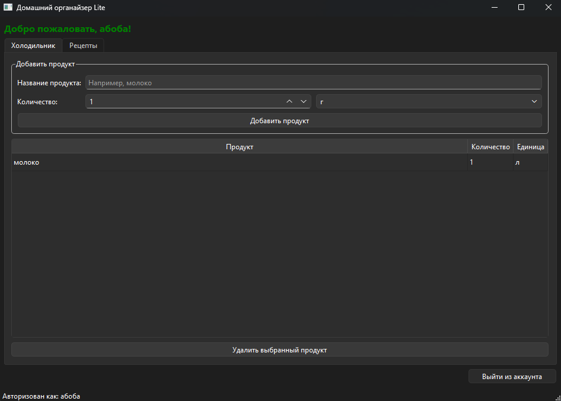
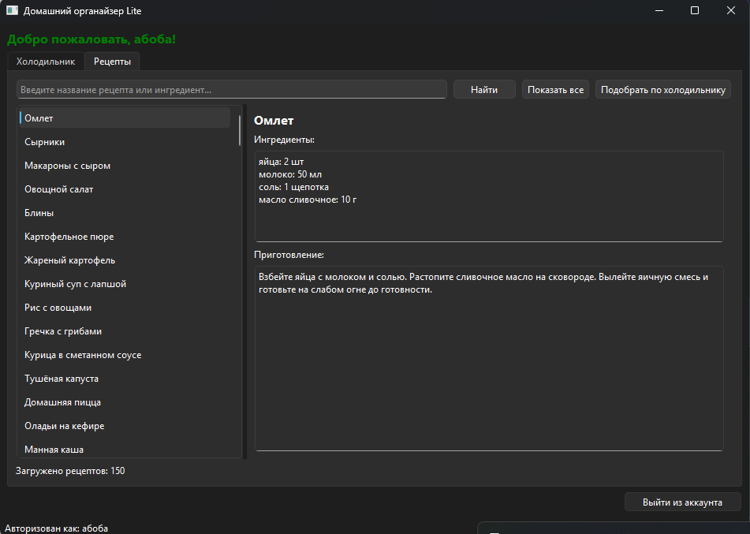
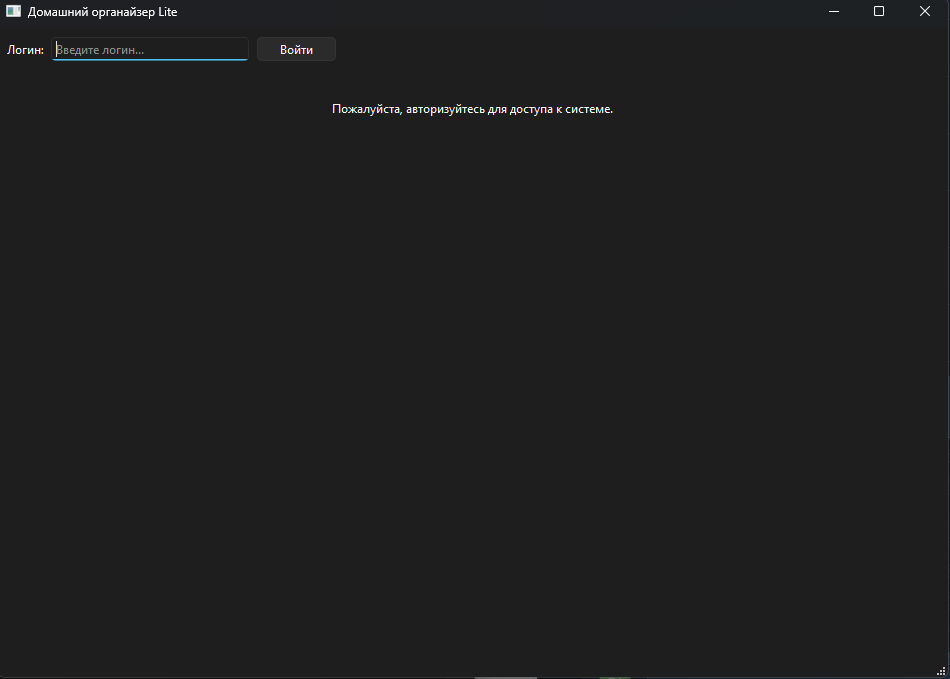

# Home Organizer Lite

Настольное приложение для работы с продуктами холодильника и каталогом рецептов.

## Возможности

- Добавление и удаление продуктов.
- Сохранение содержимого холодильника.
- Каталог из 150 рецептов.
- Поиск рецептов по названию и ингредиентам.
- Подбор рецептов по содержимому холодильника.
- Сохранение истории сеансов работы.

## Технологии

- Python
- PyQt6
- JSON
- PyInstaller

## Запуск

Установите зависимости:

```bash
python -m pip install -r requirements.txt
```

Запустите приложение:

```bash
python main.py
```

## Сборка для Windows

Приложение можно собрать с помощью PyInstaller. Готовую сборку следует скачать из раздела Releases, если она опубликована.

## Данные

Каталог рецептов хранится в `data/recipes.json`. Данные холодильника и история работы создаются локально при использовании приложения.

## Скриншоты приложения

### Холодильник



### Каталог рецептов



### Просмотр рецепта

